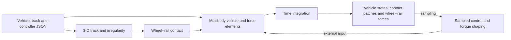

<div align="center">

# OpenRailVehicleDynamics

**English** · [简体中文](README.zh-CN.md)

**The first source-available C++ computational dynamics platform for rail vehicles**

[](LICENSE)   


</div>

**OpenRailVehicleDynamics** (ORVD) connects 3-D track, track irregularity, wheel–rail contact, the multibody vehicle, suspension and actuation, sampled control and time integration into one transparent computational chain. Users assemble a complete vehicle from JSON definitions and compute carbody and wheelset motion, per-wheel contact patches, three-component wheel–rail forces, creepages and control events.

## Core capabilities

| Area | Capability |
|---|---|
| Multibody vehicle | Rigid-body tree assembly, position and velocity kinematics, mass matrix, inverse and forward dynamics and external-force projection; translational spring–damper, series spring–viscous damper, point-to-point series spring–bilinear damper, saturating piecewise damper, roll element, reference-frame linear bushing, gravity and eight wheel–rail force and moment channels |
| Track and irregularity | Horizontal curvature, superelevation, constant grade, parabolic and circular vertical curves, quintic joints and their 3-D coupling, local station projection and boundary tangent extension; frozen spatial point sequences and reproducible AAR5/AAR6 spatial spectra, AAR5/AAR6 lateral, vertical, gauge and roll irregularities, and ERRI low lateral and vertical irregularities |
| Wheel–rail contact | Equal-arc-length profile preprocessing, wheel and rail profile interpolation, multi-patch contact geometry, EEC normal force, Kalker coefficients, FASTSIM tangential forces and per-patch creepages |
| Control and actuation | Full-state wheel-speed guidance, longitudinal cruise control and torque shaping; periodic control events committed atomically on the accepted state |
| Time integration | CVODE BDF2/BDF5, Radau5, Newmark with bounded step recovery, Zhai; unified strongly typed configuration, advancement to target times, within-step sampling and accepted-state transactions |
| Efficient computation | OpenMP parallel evaluation of the eight wheel–rail contacts with fixed-slot publication and no cross-wheel floating-point reduction, so results do not depend on the worker count; column-parallel dense finite-difference Jacobian for CVODE |
| Integration and display | Assembly from JSON definitions, relocatable CMake installation, position-independent static archives, offline dependency source bundles; `scene_observation` sampling, `scene_record` records and resources, `scene_stream` encoding, `state_stream` UDP sending and 3-D replay in the browser |



The whole chain runs on double-precision states. The track layer provides 3-D attitude and station, the wheel–rail layer turns profiles and track excitation into contact patches and forces, the multibody layer forms the continuous-state right-hand side, and time integration advances the state with dense output; periodic control events are committed atomically on the accepted state before the next dynamics segment. The track library covers tangent track, circular curves of several radii, and lines that combine horizontal curvature, superelevation and a vertical profile; IRW passive scenarios cover several speed levels from 60 to 200 km/h and can be combined with AAR5, AAR6 and ERRI low irregularities.

## Vehicle-level validation

SIMPACK serves as the vehicle-level reference. Wheel–rail forces are summed per wheel over the contact patches, and RMS and maximum differences are evaluated at common time instants; the common statistics step is `0.5 ms` for GZ18 and `10 ms` for IRW. The figures retain the native sample times; solid blue is ORVD BDF, dashed orange is SIMPACK. The IRW figures also include dotted olive Radau5 curves as an internal reference.

| Vehicle | Mechanical topology | Case | Reference solver |
|---|---|---|---|
| GZ18 | 17 bodies, four rigid wheelsets | Tangent track + AAR6, 60 km/h, 20 s | SIMPACK Time Integration with Measurements |
| GZ18 | 17 bodies, four rigid wheelsets | R300 + AAR5, 60 km/h, 50 s | SIMPACK Time Integration with Measurements |
| IRW | Four axle bridges, eight independently rotating wheels | R300 + AAR5, zero-torque passive, 60 km/h, 50 s | SIMPACK Time Integration with Measurements |
| IRW | Four axle bridges, eight independently rotating wheels | R300 + AAR5, 100 Hz full-state controlled, 60 km/h, 50 s | SIMPACK Realtime FIXBDF, 62.5 µs step |

### GZ18: rigid-wheelset vehicle

The 109-dimensional continuous state of GZ18 covers the carbody, two bogie frames, four rigid wheelsets, the suspension force elements and eight wheel–rail contacts. The figure shows lateral and yaw responses of all four wheelsets through the initial tangent, entry transition, circular curve, exit transition and final tangent.


<details>
<summary><strong>Expand: GZ18 tangent-track case, accuracy overview and all-wheel three-component wheel–rail forces</strong></summary>

**Tangent track + AAR6**: the lateral and yaw amplitudes and phases of the four wheelsets under AAR6 excitation are reproduced by both solvers; after the irregularity ends, the decay also stays synchronous.


**Accuracy overview**: each cell lists RMS / maximum difference; kinematic RMS values give the range over the four wheelsets.

| Case | Lateral (µm) | Yaw (µrad) | `N` (kN) | `Tx` (kN) | `Ty` (kN) |
|---|---:|---:|---:|---:|---:|
| Tangent track + AAR6 | `14.01–22.00 / 126.43` | `5.44–6.58 / 36.48` | `0.669 / 17.702` | `0.094 / 1.607` | `0.059 / 1.274` |
| R300 + AAR5 | `26.16–33.78 / 187.47` | `13.16–15.54 / 132.02` | `0.798 / 44.230` | `0.184 / 8.353` | `0.166 / 10.623` |

**All-wheel three-component wheel–rail forces**

Tangent track + AAR6:


R300 + AAR5:


</details>

### IRW: independently rotating wheel vehicle

IRW has 25 rigid bodies and a 169-dimensional continuous state, including 14 series internal-force states. The zero-torque passive run covers R300 at 60 km/h with four-channel AAR5 excitation for 50 s. BDF5, Radau5 and SIMPACK closely reproduce the amplitudes and phases of the four wheel pairs' lateral and yaw responses, including curve entry and the recovery after curve exit.


<details>
<summary><strong>Expand full comparison</strong></summary>

**Zero-torque passive: wheel–rail forces**


**100 Hz full-state control**: the vehicle uses full-state wheel-speed guidance and torque shaping. BDF5, Radau5 and SIMPACK FIXBDF each run the closed loop; their lateral and yaw responses remain closely aligned through the curve and into the final tangent.


**Accuracy overview**: each cell lists RMS / maximum difference between the default BDF method and SIMPACK on the common 10 ms clock. Kinematic RMS values give the range over the four wheel pairs; force RMS values combine all eight wheels. Maxima cover all corresponding channels and samples.

| Case | Lateral (mm) | Yaw (mrad) | `N` (kN) | `Tx` (kN) | `Ty` (kN) |
|---|---:|---:|---:|---:|---:|
| Zero-torque passive | `0.036–0.048 / 0.271` | `0.014–0.015 / 0.141` | `0.553 / 46.771` | `0.062 / 3.394` | `0.183 / 9.214` |
| 100 Hz full-state controlled | `0.010–0.016 / 0.113` | `0.004–0.007 / 0.075` | `0.455 / 48.652` | `0.052 / 3.855` | `0.113 / 12.399` |

</details>

### Verification layers

| Layer | What is verified |
|---|---|
| Analytical and physical properties | Rigid-body transforms, kinematics, mass matrix, inverse and forward dynamics, track geometry, contact, control recursion and the CVODE analytical system |
| Multibody operator reference | Positions, velocities, differential kinematics, mass matrix, inverse and forward dynamics and external forces checked against a cross-process Drake reference program |
| Vehicle-level time-series reference | Rigid-wheelset, independently-rotating-wheel, passive and closed-loop vehicle responses checked against SIMPACK |

The default test suite runs on Ubuntu 24.04 x86-64 (GCC 13; Clang 20 + LLVM libomp), Windows 10/11 x86-64 (MSYS2 UCRT64 GCC; CLANG64 Clang + LLVM libomp) and macOS Apple silicon arm64 (AppleClang 21 + Homebrew libomp; Homebrew GCC 15), and includes a real OpenMP team probe, a relocatable-install consumer, the plain dependency closure and the shared-Drake exclusion gate. The fixed-slot results of the eight wheel contacts do not change with the worker count, while parallel execution must still form a real multithreaded team.

## Computational performance

Linux GCC Release; 60 km/h; 8 physical cores and 8 OpenMP threads; 0.5 ms output. Values are means of two full-window runs. GZ18 uses BDF2; IRW uses BDF5.

Advance/control time covers numerical advancement, plus held-input synchronization and control computation for the controlled run. Full-process time also includes model loading, observation and result writing. The real-time factor is simulated duration divided by the corresponding wall time.

| Case | Simulated | Threads | Advance/control | Advance/control real-time factor | Full process | Full-process real-time factor |
|---|---:|---:|---:|---:|---:|---:|
| GZ18 tangent track + AAR6 | `20 s` | `8` | `3.926 s` | `5.095×` | `8.062 s` | `2.481×` |
| GZ18 R300 + AAR5 | `16 s` | `8` | `3.336 s` | `4.797×` | `6.812 s` | `2.349×` |
| IRW R300 + AAR5, passive | `50 s` | `8` | `46.101 s` | `1.085×` | `58.458 s` | `0.855×` |
| IRW R300 + AAR5, 100 Hz controlled | `50 s` | `8` | `39.158 s` | `1.277×` | `51.008 s` | `0.980×` |

Hardware, tolerances and timing ranges are documented in the [Linux evaluation](docs/performance/platform_evaluations/LINUX_X86_64.md); other platforms and timing definitions are in the [performance guide](docs/performance/README.md) (Chinese).

## Quick start

ORVD depends on Eigen 3.4.0, fmt 9.1.0, nlohmann/json 3.12.0, an OpenMP C++ runtime and SUNDIALS 7.7.0. With a dependency prefix in place it builds and installs directly:

```bash
cmake -S . -B build -G Ninja \
  -DCMAKE_BUILD_TYPE=Release \
  -DCMAKE_PREFIX_PATH=<dependency-prefix> \
  -DCMAKE_INSTALL_PREFIX=<orvd-prefix> \
  -DBUILD_TESTING=OFF
cmake --build build
cmake --install build
```

External projects consume it as a standard CMake package:

```cmake
find_package(OpenRailVehicleDynamics CONFIG REQUIRED)
target_link_libraries(my_vehicle_simulation PRIVATE ORVD::integrators)
```

<details>
<summary><strong>Targets exported by the installation</strong></summary>

14 product module targets organised by dependency level: `control`, `actuation`, `track_geometry`, `track_irregularity`, `wheel_rail_contact`, `configuration`, `multibody_runtime`, `multibody_model`, `forces`, `system_assembly`, `integrators`, plus `scene_observation` (rigid-body world-state sampling, wheel placement and track sampling), `scene_record` (portable scene records and resource bundles) and `scene_stream` (portable OSTS encoding and decoding) for 3-D observation; add the `ORVD::` namespace when linking. The vendored rigid multibody tree they depend on is installed alongside as a position-independent static archive.

</details>

On Linux the optional `ORVD::simpack_realtime` component can be built and installed explicitly to drive a local SIMPACK Realtime model through mechanical observation and four-axle differential-torque callbacks; the default product and ordinary install consumers do not depend on SIMPACK or its proprietary ABI, see the [Linux build guide](docs/build_and_install/LINUX.md#可选-simpack-realtime-组件) (Chinese). Linux also has the `ORVD::state_stream` component, off by default, which sends the observations encoded by `scene_stream` over non-blocking UDP to an independent display; build and install it with `-DORVD_BUILD_STATE_STREAM=ON`; the portable protocol and Python receiver example are documented in [scene_stream](libs/scene_stream/README.md).

Dependency installation, offline builds, tests and consumption commands for Linux, Windows and macOS are in the [build and install guide](docs/build_and_install/README.md) (Chinese); the layout of the offline source bundle is in the [dependency superbuild guide](distribution/dependencies/README.md) (Chinese).

## Repository map

| Category | Entry | Content |
|---|---|---|
| Product libraries | [`libs/`](libs/) | Installable C++ product modules and public headers |
| Assets | [`vehicle_library/`](vehicle_library/), [`track_library/`](track_library/), [`controller_library/`](controller_library/) | GZ18 and IRW mechanical models, moving startups, wheel profiles, actuation and reference models; track geometry, rail profiles and track irregularities; IRW full-state guidance, cruise control and torque shaping parameters |
| Applications | [`apps/`](apps/) | Scene viewer |
| Tools | [`tools/`](tools/) | Dynamics qualification, profile conversion, packaging, source boundary and UDP state stream |
| Experiments | [`experiments/`](experiments/) | Reusable experiment orchestration, result extraction and plotting examples |
| Tests | [`tests/`](tests/) | Analytical, property, cross-implementation, installation and platform tests |
| Third party and distribution | [`external/`](external/), [`distribution/`](distribution/) | Vendored Drake multibody tree subset and Radau5; offline dependency source bundles |
| Documentation | [`docs/`](docs/) | Build and install, models and algorithms, architecture decisions, engineering rules and performance notes |

## Documentation

- [Build and install by platform](docs/build_and_install/README.md) (Chinese)
- [Models and algorithms](docs/models_and_algorithms/README.en.md)
- [Architecture decisions](docs/adr/README.md) (Chinese)
- [Full documentation index](docs/README.md) (Chinese)

## License

First-party code is source-available under the [Business Source License 1.1](LICENSE). The standard terms permit non-production use; the Additional Use Grant further permits non-commercial production use, including academic research, teaching and personal evaluation. Commercial production use requires a separate license from the Licensor (wenquantongxin@126.com). On 2029-10-19 the Licensed Work converts to the Apache License, Version 2.0.

The vendored Drake sources remain under their BSD-3-Clause and per-file Apache-2.0 terms; third-party origins, modification statements and redistribution notes are in [`NOTICE`](NOTICE) and the [vendored source notes](external/drake_mbtree/README.md).
