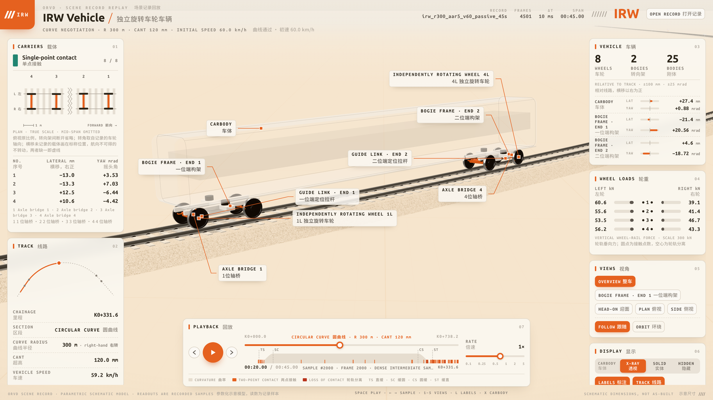
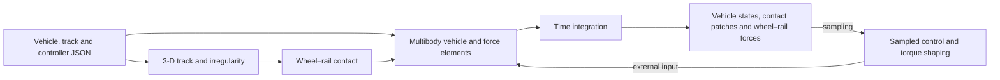
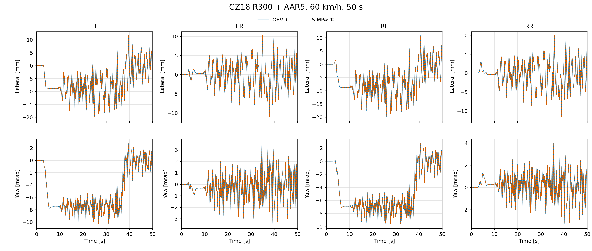
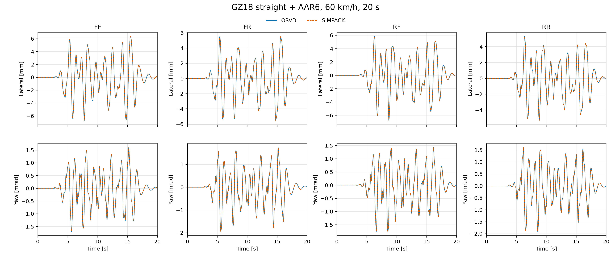
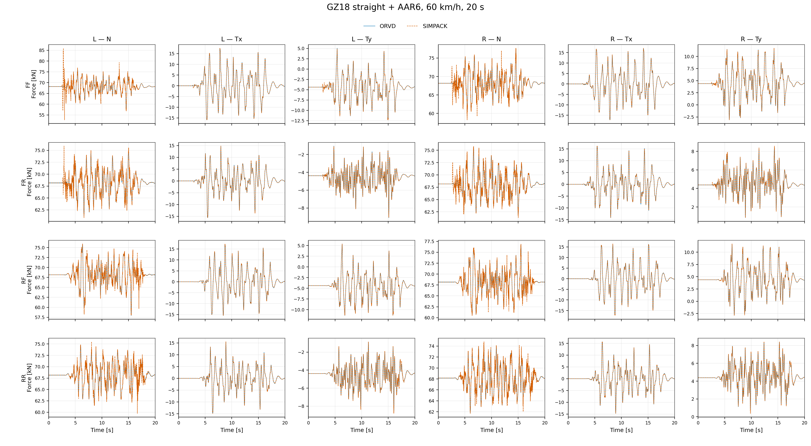
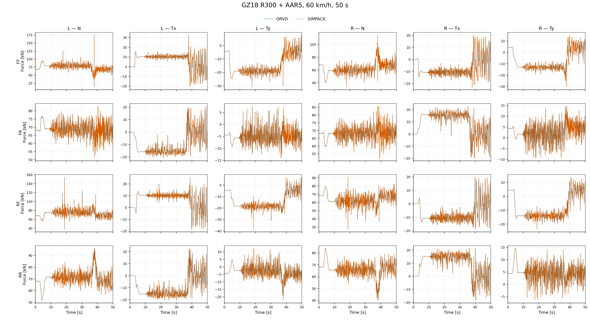
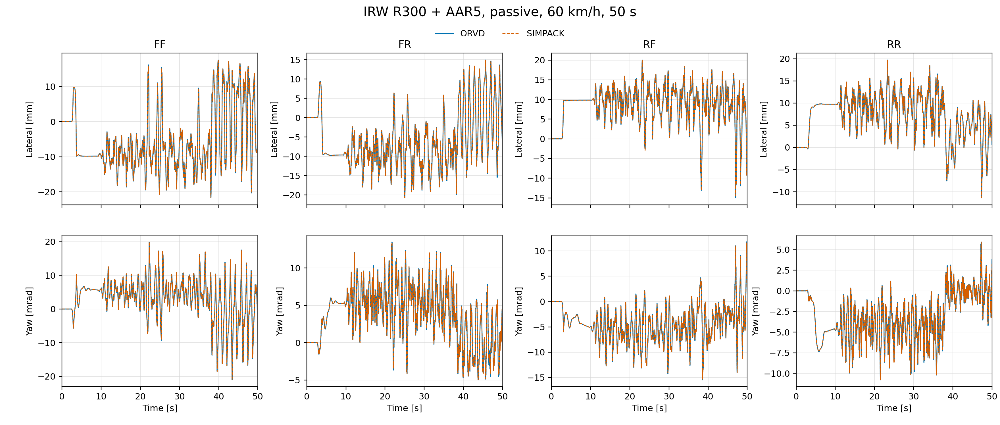
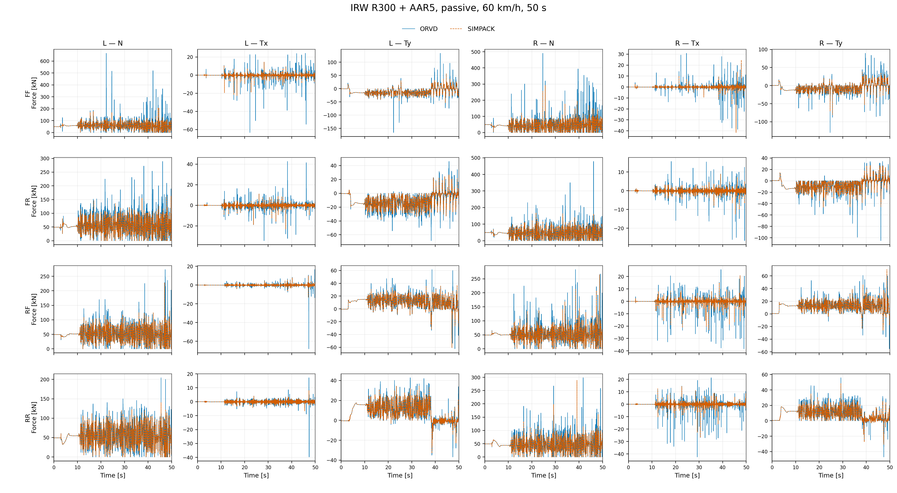
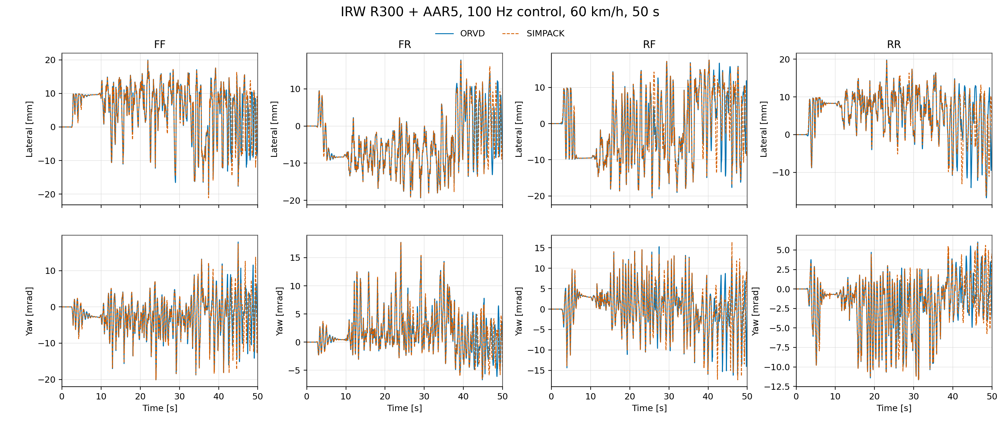
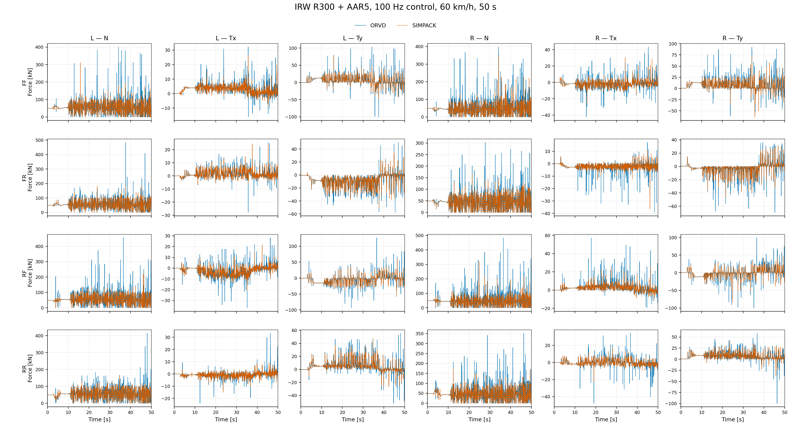

<div align="center">

# OpenRailVehicleDynamics

**English** · [简体中文](README.zh-CN.md)

**The first source-available C++ computational dynamics platform for rail vehicles**

[](LICENSE)   



</div>

**OpenRailVehicleDynamics** (ORVD) connects 3-D track, track irregularity, wheel–rail contact, the multibody vehicle, suspension and actuation, sampled control and time integration into one transparent computational chain. Users assemble a complete vehicle from JSON definitions and compute carbody and wheelset motion, per-wheel contact patches, three-component wheel–rail forces, creepages and control events.

## Core capabilities

| Area | Capability |
|---|---|
| Multibody vehicle | Rigid-body tree assembly, position and velocity kinematics, mass matrix, inverse and forward dynamics and external-force projection; translational spring–damper, series spring–viscous damper, saturating piecewise damper, roll element, six-component bushing, gravity and eight wheel–rail force and moment channels |
| Track and irregularity | Horizontal curvature, superelevation, constant grade, parabolic and circular vertical curves, quintic joints and their 3-D coupling, local station projection and boundary tangent extension; frozen spatial point sequences and reproducible AAR5/AAR6 spatial spectra, AAR5/AAR6 lateral, vertical, gauge and roll irregularities, and ERRI low lateral and vertical irregularities |
| Wheel–rail contact | Equal-arc-length profile preprocessing, wheel and rail profile interpolation, multi-patch contact geometry, EEC normal force, Kalker coefficients, FASTSIM tangential forces and per-patch creepages |
| Control and actuation | Full-state wheel-speed guidance, longitudinal cruise control and torque shaping; periodic control events committed atomically on the accepted state |
| Time integration | CVODE BDF2/BDF5, Radau5, Newmark with bounded step recovery, Zhai; unified strongly typed configuration, advancement to target times, within-step sampling and accepted-state transactions |
| Efficient computation | OpenMP parallel evaluation of the eight wheel–rail contacts with fixed-slot publication and no cross-wheel floating-point reduction, so results do not depend on the worker count; column-parallel dense finite-difference Jacobian for CVODE |
| Integration and display | Assembly from JSON definitions, relocatable CMake installation, position-independent static archives, offline dependency source bundles; `scene_observation` sampling, `scene_record` records and resources, `scene_stream` encoding, `state_stream` UDP sending and 3-D replay in the browser |



The whole chain runs on double-precision states. The track layer provides 3-D attitude and station, the wheel–rail layer turns profiles and track excitation into contact patches and forces, the multibody layer forms the continuous-state right-hand side, and time integration advances the state with dense output; periodic control events are committed atomically on the accepted state before the next dynamics segment. The track library covers tangent track, circular curves of several radii, and lines that combine horizontal curvature, superelevation and a vertical profile; IRW passive scenarios cover several speed levels from 60 to 200 km/h and can be combined with AAR5, AAR6 and ERRI low irregularities.

## Vehicle-level validation

SIMPACK serves as the vehicle-level reference. Wheel–rail forces are summed per wheel over the contact patches, and RMS and maximum differences are evaluated at common time instants; the common statistics step is `0.5 ms` for GZ18 and `10 ms` for IRW. The wheel–rail force figures show the native `N/Tx/Ty` series of all wheels; solid blue is ORVD, dashed orange is SIMPACK.

| Vehicle | Mechanical topology | Case | Reference solver |
|---|---|---|---|
| GZ18 | 17 bodies, four rigid wheelsets | Tangent track + AAR6, 60 km/h, 20 s | SIMPACK Time Integration with Measurements |
| GZ18 | 17 bodies, four rigid wheelsets | R300 + AAR5, 60 km/h, 50 s | SIMPACK Time Integration with Measurements |
| IRW | Four axle bridges, eight independently rotating wheels | R300 + AAR5, zero-torque passive, 60 km/h, 50 s | SIMPACK Time Integration with Measurements |
| IRW | Four axle bridges, eight independently rotating wheels | R300 + AAR5, 100 Hz full-state controlled, 60 km/h, 50 s | SIMPACK Realtime |

### GZ18: rigid-wheelset vehicle

The 109-dimensional continuous state of GZ18 covers the carbody, two bogie frames, four rigid wheelsets, the suspension force elements and eight wheel–rail contacts. The figure shows lateral and yaw responses of all four wheelsets through the initial tangent, entry transition, circular curve, exit transition and final tangent.



<details>
<summary><strong>Expand: GZ18 tangent-track case, accuracy overview and all-wheel three-component wheel–rail forces</strong></summary>

**Tangent track + AAR6**: the lateral and yaw amplitudes and phases of the four wheelsets under AAR6 excitation are reproduced by both solvers; after the irregularity ends, the decay also stays synchronous.



**Accuracy overview**: each cell lists RMS / maximum difference; kinematic RMS values give the range over the four wheelsets.

| Case | Lateral (µm) | Yaw (µrad) | `N` (kN) | `Tx` (kN) | `Ty` (kN) |
|---|---:|---:|---:|---:|---:|
| Tangent track + AAR6 | `14.01–22.00 / 126.43` | `5.44–6.58 / 36.48` | `0.669 / 17.702` | `0.094 / 1.607` | `0.059 / 1.274` |
| R300 + AAR5 | `26.16–33.78 / 187.47` | `13.16–15.54 / 132.02` | `0.798 / 44.230` | `0.184 / 8.353` | `0.166 / 10.623` |

**All-wheel three-component wheel–rail forces**

Tangent track + AAR6:



R300 + AAR5:



</details>

### IRW: independently rotating wheel vehicle

The 157-dimensional continuous state of IRW contains four axle bridges and eight independently rotating wheels. No drive torque is applied to any wheel throughout the run. The figure shows the axle-bridge lateral and yaw response on the R300 curve under AAR5 excitation.



<details>
<summary><strong>Expand full comparison</strong></summary>

**Zero-torque passive: wheel–rail forces**



**100 Hz full-state control**: the vehicle uses full-state wheel-speed guidance and torque shaping.





**Accuracy overview**: each cell lists RMS / maximum difference; kinematic RMS values give the range over the four axle bridges.

| Case | Lateral (mm) | Yaw (mrad) | `N` (kN) | `Tx` (kN) | `Ty` (kN) |
|---|---:|---:|---:|---:|---:|
| Zero-torque passive | `0.079–0.241 / 4.169` | `0.077–0.193 / 1.931` | `9.170 / 288.691` | `0.778 / 37.055` | `2.142 / 66.533` |
| 100 Hz full-state controlled | `2.956–3.592 / 22.962` | `1.323–2.724 / 23.125` | `12.488 / 405.409` | `1.604 / 37.934` | `4.880 / 93.233` |

</details>

### Verification layers

| Layer | What is verified |
|---|---|
| Analytical and physical properties | Rigid-body transforms, kinematics, mass matrix, inverse and forward dynamics, track geometry, contact, control recursion and the CVODE analytical system |
| Multibody operator reference | Positions, velocities, differential kinematics, mass matrix, inverse and forward dynamics and external forces checked against a cross-process Drake reference program |
| Vehicle-level time-series reference | Rigid-wheelset, independently-rotating-wheel, passive and closed-loop vehicle responses checked against SIMPACK |

The default test suite runs on Ubuntu 24.04 x86-64 (GCC 13; Clang 20 + LLVM libomp), Windows 10/11 x86-64 (MSYS2 UCRT64 GCC; CLANG64 Clang + LLVM libomp) and macOS Apple silicon arm64 (AppleClang 21 + Homebrew libomp; Homebrew GCC 15), and includes a real OpenMP team probe, a relocatable-install consumer, the plain dependency closure and the shared-Drake exclusion gate. The fixed-slot results of the eight wheel contacts do not change with the worker count, while parallel execution must still form a real multithreaded team.

## Computational performance

The dynamics advancement wall clock covers the integration backend, the vehicle right-hand side and the accepted-state transactions of the run's configuration; the controlled case additionally counts hold-value synchronisation and control computation; the full process also includes observation replay, result organisation and writing. The real-time factor is the simulated duration divided by the corresponding wall clock. The table lists the means of two full-window runs of a Release build of the current source with 8 OpenMP threads, a 0.5 ms sampling period and each scenario's default CVODE recipe: BDF2 for GZ18 and the 100 Hz controlled IRW, BDF5 for the zero-torque passive IRW.

| Case | Simulated | Advance / control | Advance real-time factor | Full process | Full-process real-time factor |
|---|---:|---:|---:|---:|---:|
| GZ18 tangent track + AAR6 | `20 s` | `4.007 s` | `4.992×` | `8.148 s` | `2.455×` |
| GZ18 R300 + AAR5 | `16 s` | `3.303 s` | `4.844×` | `6.847 s` | `2.337×` |
| IRW zero-torque passive | `30 s` | `26.338 s` | `1.139×` | `33.677 s` | `0.891×` |
| IRW 100 Hz full-state controlled | `30 s` | `21.514 s` | `1.394×` | `29.977 s` | `1.001×` |

The core advancement of all four cases is faster than real time. In the validation batch, the SIMPACK full-process times of the same cases were `60.13 / 48.14 / 38.28 / 155.23 s`; the two batches were not run side by side, so no speed-up ratio is computed. The single-thread computational cost, wall clock and deviation from the Radau5 reference trajectory of the five integration methods on the four cases are in the [integration method evaluation](docs/performance/integrator_evaluations/LINUX_X86_64_SINGLE_THREAD.md) (Chinese); the full Linux timings, breakdown and execution conditions are in the [Linux x86-64 evaluation](docs/performance/platform_evaluations/LINUX_X86_64.md) (Chinese), and the current results and timing definitions in the [performance documentation](docs/performance/README.md) (Chinese).

## Quick start

ORVD depends on Eigen 3.4.0, fmt 9.1.0, nlohmann/json 3.12.0, an OpenMP C++ runtime and SUNDIALS 7.7.0. With a dependency prefix in place it builds and installs directly:

```bash
cmake -S . -B build -G Ninja \
  -DCMAKE_BUILD_TYPE=Release \
  -DCMAKE_PREFIX_PATH=<dependency-prefix> \
  -DCMAKE_INSTALL_PREFIX=<orvd-prefix> \
  -DBUILD_TESTING=OFF
cmake --build build
cmake --install build
```

External projects consume it as a standard CMake package:

```cmake
find_package(OpenRailVehicleDynamics CONFIG REQUIRED)
target_link_libraries(my_vehicle_simulation PRIVATE ORVD::integrators)
```

<details>
<summary><strong>Targets exported by the installation</strong></summary>

14 product module targets organised by dependency level: `control`, `actuation`, `track_geometry`, `track_irregularity`, `wheel_rail_contact`, `configuration`, `multibody_runtime`, `multibody_model`, `forces`, `system_assembly`, `integrators`, plus `scene_observation` (rigid-body world-state sampling, wheel placement and track sampling), `scene_record` (portable scene records and resource bundles) and `scene_stream` (portable OSTS encoding and decoding) for 3-D observation; add the `ORVD::` namespace when linking. The vendored rigid multibody tree they depend on is installed alongside as a position-independent static archive.

</details>

On Linux the optional `ORVD::simpack_realtime` component can be built and installed explicitly to drive a local SIMPACK Realtime model through mechanical observation and four-axle differential-torque callbacks; the default product and ordinary install consumers do not depend on SIMPACK or its proprietary ABI, see the [Linux build guide](docs/build_and_install/LINUX.md#可选-simpack-realtime-组件) (Chinese). Linux also has the `ORVD::state_stream` component, off by default, which sends the observations encoded by `scene_stream` over non-blocking UDP to an independent display; build and install it with `-DORVD_BUILD_STATE_STREAM=ON`; the portable protocol and Python receiver example are documented in [scene_stream](libs/scene_stream/README.md).

Dependency installation, offline builds, tests and consumption commands for Linux, Windows and macOS are in the [build and install guide](docs/build_and_install/README.md) (Chinese); the layout of the offline source bundle is in the [dependency superbuild guide](distribution/dependencies/README.md) (Chinese).

## Repository map

| Category | Entry | Content |
|---|---|---|
| Product libraries | [`libs/`](libs/) | Installable C++ product modules and public headers |
| Assets | [`vehicle_library/`](vehicle_library/), [`track_library/`](track_library/), [`controller_library/`](controller_library/) | GZ18 and IRW mechanical models, moving startups, wheel profiles, actuation and reference models; track geometry, rail profiles and track irregularities; IRW full-state guidance, cruise control and torque shaping parameters |
| Applications | [`apps/`](apps/) | Scene viewer |
| Tools | [`tools/`](tools/) | Dynamics qualification, profile conversion, packaging, source boundary and UDP state stream |
| Experiments | [`experiments/`](experiments/) | Reusable experiment orchestration, result extraction and plotting examples |
| Tests | [`tests/`](tests/) | Analytical, property, cross-implementation, installation and platform tests |
| Third party and distribution | [`external/`](external/), [`distribution/`](distribution/) | Vendored Drake multibody tree subset and Radau5; offline dependency source bundles |
| Documentation | [`docs/`](docs/) | Build and install, models and algorithms, architecture decisions, engineering rules and performance notes |

## Documentation

- [Build and install by platform](docs/build_and_install/README.md) (Chinese)
- [Models and algorithms](docs/models_and_algorithms/README.en.md)
- [Architecture decisions](docs/adr/README.md) (Chinese)
- [Full documentation index](docs/README.md) (Chinese)

## License

First-party code is source-available under the [Business Source License 1.1](LICENSE). The standard terms permit non-production use; the Additional Use Grant further permits non-commercial production use, including academic research, teaching and personal evaluation. Commercial production use requires a separate license from the Licensor (wenquantongxin@126.com). On 2029-10-19 the Licensed Work converts to the Apache License, Version 2.0.

The vendored Drake sources remain under their BSD-3-Clause and per-file Apache-2.0 terms; third-party origins, modification statements and redistribution notes are in [`NOTICE`](NOTICE) and the [vendored source notes](external/drake_mbtree/README.md).
