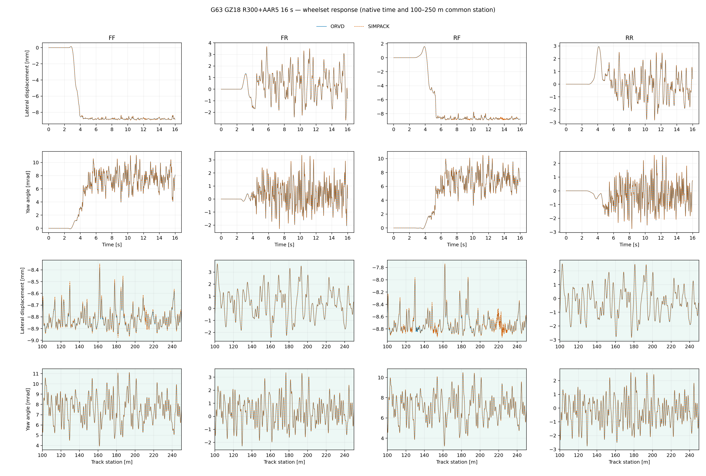
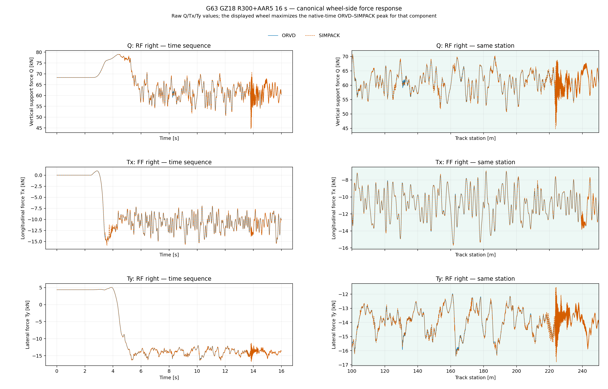
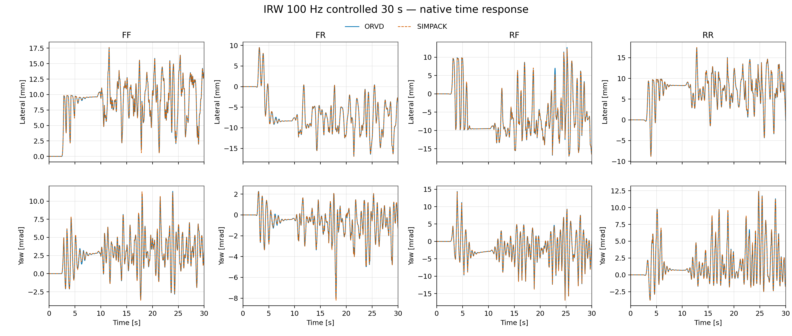
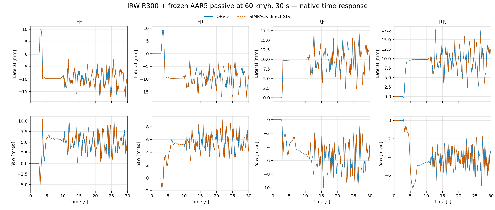
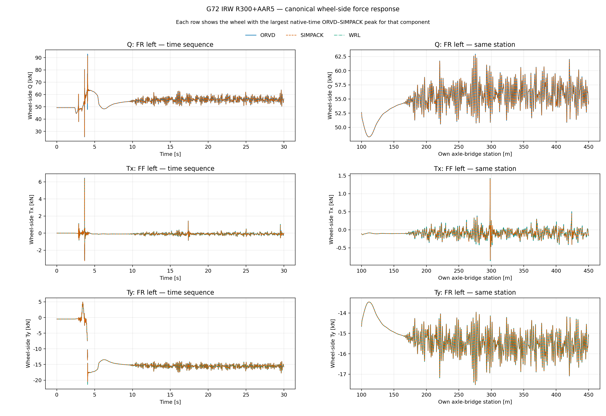
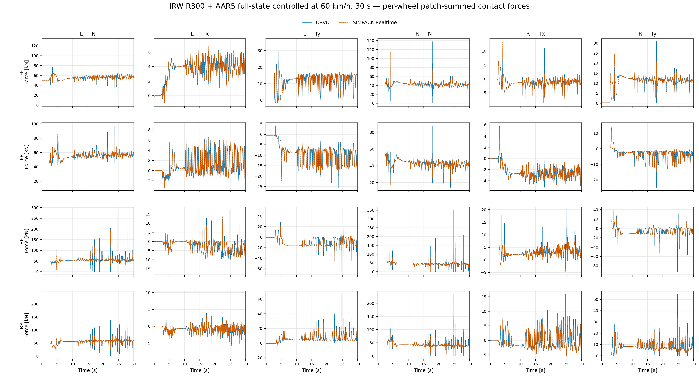

<div align="center">

# OpenRailVehicleDynamics

[English](README.md) · **简体中文**

**首款面向轨道车辆的开源 C++ 动力学计算平台**

[](LICENSE)   


</div>

**OpenRailVehicleDynamics**（ORVD）将三维线路、轨道不平顺、轮轨接触、车辆多体系统、悬挂与作动、采样控制和时间积分连接为一条透明的计算链。用户以 JSON 定义装配完整车辆，计算车体与轮对运动、逐轮接触斑、三向轮轨力、蠕滑率和控制事件。

## 核心能力

| 领域 | 能力 |
|---|---|
| 多体车辆 | 刚体树装配、位置／速度运动学、质量矩阵、逆／前向动力学与外力投影；平动弹簧阻尼、串联弹簧黏性阻尼、饱和分段阻尼、侧滚元、六分量衬套、重力与八路轮轨力和力矩 |
| 线路与不平顺 | 平面曲率、超高、恒坡、抛物线与圆弧竖曲线、五次接缝及其三维耦合，局部站位投影与边界切线延长；冻结空间点列与可复核的 AAR5／AAR6 空间谱，AAR5／AAR6 横向、竖向、轨距与侧滚不平顺，ERRI low 横／垂向不平顺 |
| 轮轨接触 | 等弧长型面预处理、轮轨外形插值、多接触斑几何、EEC 法向力、Kalker 系数、FASTSIM 切向力与逐斑蠕滑率 |
| 控制与作动 | 全状态轮速导向、纵向巡航控制与转矩整形；周期控制事件在接受态上原子提交 |
| 时间积分 | CVODE BDF2／BDF5、Radau5、带有界缩步恢复的 Newmark、Zhai；统一强类型配置、目标时刻推进、步内采样与接受态事务 |
| 高效计算 | 八处轮轨接触的 OpenMP 并行求值，固定槽发布、无跨轮浮点归约，结果不随工作者数量变化；CVODE 稠密差分 Jacobian 按列并行 |
| 集成与展示 | JSON 定义装配、可重定位 CMake 安装、位置无关静态归档、离线依赖源码包；`scene_observation` 采样、`scene_record` 记录与资源、`scene_stream` 编码、`state_stream` UDP 发送、浏览器三维回放 |


整条计算链以双精度状态运行。线路层负责三维姿态和站位，轮轨层把型面与轨道激励转换为接触斑及作用力，多体层形成连续状态右端，时间积分完成推进与稠密输出；周期控制事件在接受态上原子提交，再进入下一段动力学。线路库覆盖直线、多种半径的圆曲线，以及同时包含平面曲线、超高和竖向剖面的线路；IRW 被动场景覆盖 60–200 km/h 的多个速度等级，可组合 AAR5、AAR6 与 ERRI low 不平顺。

## 整车验证

SIMPACK 承担整车参考。轮轨力按车轮汇总接触斑后，在共同时刻上统计均方根与最大差；GZ18 的共同统计步长为 `0.5 ms`，IRW 为 `10 ms`。轮轨力图统一展示全部车轮的 `N/Tx/Ty` 原生时序；蓝色实线为 ORVD，橙色虚线为 SIMPACK。

| 车辆 | 机械拓扑 | 对标工况 | 参考求解 |
|---|---|---|---|
| GZ18 | 17 体、四个刚性轮对 | 直线＋AAR6，60 km/h，20 s | SIMPACK 离线积分 |
| GZ18 | 17 体、四个刚性轮对 | R300＋AAR5，60 km/h，16 s | SIMPACK 离线积分 |
| IRW | 四轴桥、八个独立旋转车轮 | R300＋AAR5，零转矩被动，60 km/h，30 s | SIMPACK 离线积分 |
| IRW | 四轴桥、八个独立旋转车轮 | R300＋AAR5，100 Hz 全状态受控，60 km/h，30 s | SIMPACK 实时仿真 |

### GZ18：刚性轮对车辆

GZ18 的 109 维连续状态覆盖整车、两个构架、四个刚性轮对、悬挂力元和八处轮轨接触。进入 R300 曲线后的稳态偏置、前后转向架差异和 AAR5 激励响应在四个轮对上保持一致，说明线路几何、超高、型面和车辆动力学已经在同一时序中闭合。



<details>
<summary><strong>展开查看 GZ18 直线工况、对标精度总览与全轮三向轮轨力</strong></summary>

**直线＋AAR6**：四个轮对在 AAR6 激励下的横移、摇头幅值和相位由两套求解器共同复现；不平顺退出后，衰减过程也保持同步。


**对标精度总览**：表内依次为均方根／最大差；运动学均方根给出四轮对范围。

| 工况 | 横移（µm） | 摇头（µrad） | `N`（kN） | `Tx`（kN） | `Ty`（kN） |
|---|---:|---:|---:|---:|---:|
| 直线＋AAR6 | `15.16–19.02 / 66.08` | `5.20–6.57 / 33.38` | `0.654 / 12.320` | `0.080 / 1.617` | `0.055 / 1.348` |
| R300＋AAR5 | `7.43–8.94 / 56.76` | `3.73–5.46 / 40.44` | `0.540 / 22.372` | `0.105 / 4.128` | `0.115 / 4.881` |

R300 工况的力最大差集中在 AAR5 淡入段的轮轨力点状尖峰；均方根显示完整时序中的主体响应仍保持亚千牛级差异。

**全轮三向轮轨力**

直线＋AAR6：


R300＋AAR5：



</details>

### IRW：独立旋转车轮车辆

IRW 的 157 维连续状态包含四个轴桥和八个独立旋转车轮。它没有刚性轮对提供的轮速约束，轮缘—钢轨边界、轨道不平顺和主动轮速导向会形成与传统轮对车辆明显不同的动力学模态。同一车辆接入全状态轮速导向与转矩整形后，图中展示 100 Hz 闭环介入下形成的四轴桥横移与摇头响应。



<details>
<summary><strong>展开查看 IRW 零转矩被动工况、对标精度总览与全轮三向轮轨力</strong></summary>

**零转矩被动运行**：八个车轮全程不给驱动转矩。图中展示独立车轮在 R300 曲线和 AAR5 激励下形成的四轴桥横移与摇头响应，以及 ORVD 与 SIMPACK 对自然演化过程的复现程度。



**对标精度总览**：表内依次为均方根／最大差；运动学均方根给出四轴桥范围。

| 工况 | 横移（mm） | 摇头（mrad） | `N`（kN） | `Tx`（kN） | `Ty`（kN） |
|---|---:|---:|---:|---:|---:|
| 零转矩被动 | `0.010–0.023 / 0.366` | `0.015–0.023 / 0.236` | `0.169 / 13.674` | `0.030 / 1.665` | `0.077 / 8.497` |
| 100 Hz 全状态受控 | `0.067–0.273 / 3.144` | `0.060–0.169 / 1.525` | `3.667 / 198.480` | `0.414 / 13.679` | `0.990 / 45.294` |

零转矩被动工况的横移与摇头均方根分别不超过 `0.023 mm` 和 `0.023 mrad`；闭环工况的横移与摇头响应同样逐轴闭合，离散接触切换处的力尖峰仍决定全局最大差。

**全轮三向轮轨力**

零转矩被动：



100 Hz 全状态受控：



</details>

### 验证层级

| 层级 | 验证内容 |
|---|---|
| 解析与物理性质 | 刚体变换、运动学、质量矩阵、逆／前向动力学、轨道几何、接触、控制递推和 CVODE 解析系统 |
| 多体算子参照 | 通过跨进程 Drake 参考程序核对位置、速度、微分运动学、质量矩阵、逆／前向动力学和外力 |
| 整车时序参照 | 通过 SIMPACK 核对刚性轮对、独立车轮、被动运行和闭环控制的车辆响应 |

默认测试集合在 Ubuntu 24.04 x86-64（GCC 13；Clang 20＋LLVM libomp）、Windows 10／11 x86-64（MSYS2 UCRT64 GCC；CLANG64 Clang＋LLVM libomp）与 macOS Apple silicon arm64（AppleClang 21＋Homebrew libomp；Homebrew GCC 15）上运行，包含真实 OpenMP 团队探针、可重定位安装消费者、普通依赖闭包和共享 Drake 排除门。八轮接触的固定槽结果不随工作者数量变化；并行执行仍必须实际形成多线程团队。

## 计算性能

动力学推进墙钟计算当次配置的积分后端、车辆右端和接受态事务；受控工况另计保持量同步与控制计算；完整进程还包含观测重放、结果组织和写出。实时系数为仿真时长除以对应墙钟。下表为当前源码的 Release 构建在 8 个 OpenMP 线程、0.5 ms 采样周期与各场景默认 CVODE 配方下两次完整窗口的均值：GZ18 与 100 Hz 受控 IRW 为 BDF2，零转矩被动 IRW 为 BDF5。

| 工况 | 仿真时长 | 推进／控制 | 推进实时系数 | 完整进程 | 完整实时系数 |
|---|---:|---:|---:|---:|---:|
| GZ18 直线＋AAR6 | `20 s` | `4.007 s` | `4.992×` | `8.148 s` | `2.455×` |
| GZ18 R300＋AAR5 | `16 s` | `3.303 s` | `4.844×` | `6.847 s` | `2.337×` |
| IRW 零转矩被动 | `30 s` | `26.338 s` | `1.139×` | `33.677 s` | `0.891×` |
| IRW 100 Hz 全状态受控 | `30 s` | `21.514 s` | `1.394×` | `29.977 s` | `1.001×` |

表列四项工况的核心推进均超过实时。对标批次中 SIMPACK 同工况的完整进程为 `60.13 / 48.14 / 38.28 / 155.23 s`；两批不在同场，不计算加速比。五种积分方法在四工况上的单线程计算量、墙钟及相对 Radau5 参考轨迹的差值见[时间积分方法评价](docs/performance/integrator_evaluations/LINUX_X86_64_SINGLE_THREAD.md)；Linux 平台的完整计时、分项与执行条件见 [Linux x86-64 计算评价](docs/performance/platform_evaluations/LINUX_X86_64.md)，现行结果与计时口径见[计算性能文档](docs/performance/README.md)。

## 快速开始

ORVD 依赖 Eigen 3.4.0、fmt 9.1.0、nlohmann/json 3.12.0、OpenMP C++ 运行时和 SUNDIALS 7.7.0。已有依赖前缀时可以直接构建和安装：

```bash
cmake -S . -B build -G Ninja \
  -DCMAKE_BUILD_TYPE=Release \
  -DCMAKE_PREFIX_PATH=<dependency-prefix> \
  -DCMAKE_INSTALL_PREFIX=<orvd-prefix> \
  -DBUILD_TESTING=OFF
cmake --build build
cmake --install build
```

外部工程通过标准 CMake 包消费：

```cmake
find_package(OpenRailVehicleDynamics CONFIG REQUIRED)
target_link_libraries(my_vehicle_simulation PRIVATE ORVD::integrators)
```

<details>
<summary><strong>安装包导出的目标</strong></summary>

按依赖层级组织的 14 个产品模块目标：`control`、`actuation`、`track_geometry`、`track_irregularity`、`wheel_rail_contact`、`configuration`、`multibody_runtime`、`multibody_model`、`forces`、`system_assembly`、`integrators`，以及面向三维观察的 `scene_observation`（刚体世界状态采样、车轮放置与线路采样）、`scene_record`（场景记录与资源包读写）和 `scene_stream`（可移植 OSTS 编解码）；使用时添加 `ORVD::` 命名空间。它们依赖的 vendored 刚体多体树一并安装为位置无关静态归档。

</details>

Linux 可显式构建并安装 `ORVD::simpack_realtime` 可选组件，以机械观测和四轴差动转矩回调驱动本机 SIMPACK Realtime 模型；默认产品及普通安装消费者不依赖 SIMPACK 或其专有 ABI，完整命令见 [Linux 构建说明](docs/build_and_install/LINUX.md#可选-simpack-realtime-组件)。Linux 另有默认关闭的 `ORVD::state_stream` 组件，把 `scene_stream` 编码的观测以非阻塞 UDP 发送给独立显示器，通过 `-DORVD_BUILD_STATE_STREAM=ON` 构建安装；可移植协议与 Python 接收示例见 [scene_stream](libs/scene_stream/README.md)。

Linux、Windows 与 macOS 的依赖安装、离线构建、测试及消费命令见[分平台构建与安装说明](docs/build_and_install/README.md)；离线源码包的内部结构见[依赖超级构建说明](distribution/dependencies/README.md)。

## 仓库导航

| 类别 | 入口 | 内容 |
|---|---|---|
| 产品库 | [`libs/`](libs/) | 可安装的 C++ 产品模块与公共头 |
| 资产 | [`vehicle_library/`](vehicle_library/)、[`track_library/`](track_library/)、[`controller_library/`](controller_library/) | GZ18、IRW 机械模型、移动启动、轮型、作动与参考模型；线路几何、钢轨型面与轨道不平顺；IRW 全状态导向、巡航控制与转矩整形参数 |
| 应用 | [`apps/`](apps/) | 场景查看器 |
| 工具 | [`tools/`](tools/) | 动力学资格、型面转换、打包、源码边界与 UDP 状态流 |
| 实验 | [`experiments/`](experiments/) | 可复用的实验编排、结果提取与绘图示例 |
| 测试 | [`tests/`](tests/) | 解析、性质、跨实现、安装和平台测试 |
| 第三方与分发 | [`external/`](external/)、[`distribution/`](distribution/) | vendored Drake 多体树子集与 Radau5；离线依赖源码包 |
| 文档 | [`docs/`](docs/) | 构建安装、模型算法、架构决策、工程规则和性能说明 |

## 文档入口

- [分平台构建与安装](docs/build_and_install/README.md)
- [模型与算法](docs/models_and_algorithms/README.md)
- [架构决策](docs/adr/README.md)
- [完整文档索引](docs/README.md)

## 许可

第一方代码以 [Business Source License 1.1](LICENSE) 源码公开。标准条款允许非生产使用；附加使用授权进一步允许非商业的生产使用，包括学术研究、教学与个人评估。商业生产使用需向许可方（wenquantongxin@126.com）另行取得授权。2029-10-19 起，授权作品转为 Apache License 2.0。

vendored Drake 源码遵循其 BSD-3-Clause 与逐文件注明的 Apache-2.0 条款；第三方来源、修改声明和再分发信息见 [`NOTICE`](NOTICE) 与 [vendored 源码说明](external/drake_mbtree/README.md)。
